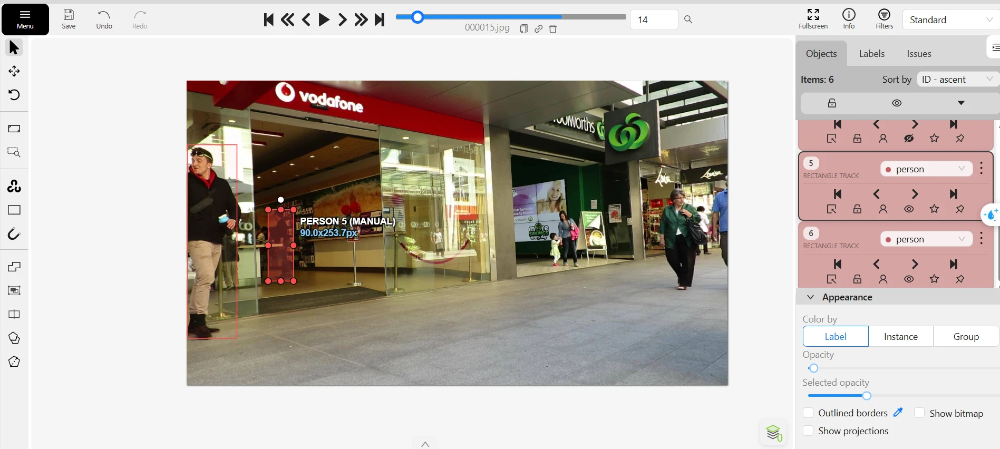
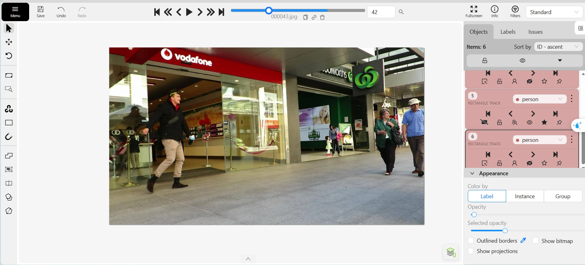
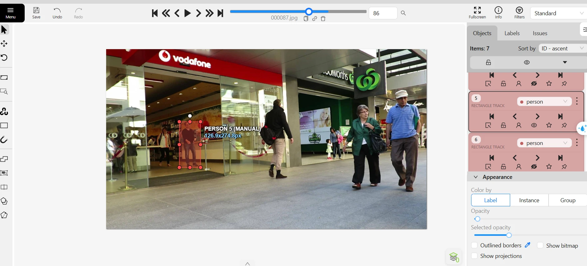

# Báo cáo cá nhân — NguyenVanTho-2A202603299

Đoạn video: MOT17-09, 150 frame (frame 1–150), nguồn MOTChallenge, giấy phép CC BY-NC-SA 3.0.

## 0. Thông tin học viên

- Họ tên: Nguyen Van Tho
- MSSV: 2A202603299
- Mã đề (A/B/C): A
- Email: thonguyen28.nitc@gmail.com
- Link repository: https://github.com/NguyenVanTho2805/K5-L2B-DAY05-NguyenVanTho-2A202603299-MOTTracking
- Giờ bắt đầu: 16:30
- Giờ kết thúc: 18:30

## 1. Xem trước đoạn video (CP0)

Ghi **trước khi vẽ**, mỗi người một dòng.

| Mã | Frame xuất hiện | Frame cuối thấy được | Rẽ / dừng / đổi tốc độ ở frame | Bị che ở frame | Ghi chú |
|---|---|---|---|---|---|
| P1 | 0 | 149 | Đi chậm sang phải từ frame 0 đến khoảng 100, dừng khoảng 100–120, rồi nhích sang trái từ khoảng 120 | 30–41 (một phần), 42–49 (hẳn) | Người áo len đen trong shop Vodafone |
| P2 | 45 | 149 | Bước ra cửa shop khoảng 55–75 (hộp to rất nhanh), dừng khoảng 110–125, rồi lại gần camera từ khoảng 130 | Không bị che hẳn; mờ sau lớp kính ở frame 45–55 | Cô gái áo trắng có mảng cam, quần đen |
| P3 | 0 | 149 | Tiến lại gần camera và nhanh dần (khoảng 2 px/frame ở đầu lên khoảng 10 px/frame ở frame 140), nhanh rõ từ khoảng 100 | Không | Bà tóc bạc, áo xanh lá, túi đen; đi sát P4, đi qua trước mặt P5 khoảng frame 108–137 |
| P4 | 0 (chỉ lộ một phần ở mép phải đến khoảng frame 10) | 149 | Vào khung khoảng 10–20; đi cạnh P3, nhanh dần từ khoảng 100 | Không | Ông đội mũ be, áo polo xanh lam |
| P5 | 0 | 149 | Đi chậm sang phải 0–30; gần như đứng yên 40–110 | 108–111 (một phần), 112–137 (hẳn) | Bé gái váy trắng xanh nhạt, giày đỏ, đi cạnh người mẹ |

Số liệu trong bảng được tổng hợp lại từ hộp đã gán trên CVAT (vị trí, tốc độ và kích thước hộp theo từng 10 frame).

## 2. Keyframe và thời gian (CP1, CP4)

Số keyframe lấy từ kết quả `src/check_submission.py`. Frame ghi theo CVAT (bắt đầu từ 0).

Ánh xạ người ↔ track (đối chiếu tọa độ tham chiếu của đề A trong `src/lab_variants.json` với hộp trong file xuất):

| Mã | ID MOT17 | Object ID trong CVAT | Track trong bảng CVAT for video | Track trong bảng MOT 1.1 |
|---|---:|---:|---:|---:|
| P1 | 1 | 5 | 4 | 5 |
| P2 | 7 | 7 | 6 | 7 |
| P3 | 19 | 1 | 0 | 1 |
| P4 | 20 | 2 | 1 | 2 |
| P5 | 21 | 3 | 2 | 3 |

Ngoài 5 người trên, file còn 2 track thêm (track 3 và 5 trong bảng CVAT for video), được gán thêm theo hướng dẫn của coach.

| Mã | Số keyframe | Keyframe ở frame | Số frame có mặt | Keyframe / 100 frame | Thời gian (phút) | Chỗ khó |
|---|---:|---|---:|---:|---|---|
| P1 | 15 | 0, 10, 20, 30, 50, 60, 70, 80, 90, 100, 110, 119, 130, 140, 149 | 142 | 10,6 | 10 | Bị người đi ngang che (che một phần 30–41, mất hẳn 42–49); dừng và đổi hướng nhẹ khoảng frame 100–120 |
| P2 | 14 | 45, 54, 60, 68, 77, 83, 90, 98, 104, 112, 119, 127, 138, 149 | 105 | 13,3 | 5 | Mờ sau lớp kính ở frame 45–55; bước ra cửa shop khoảng 55–75 nên hộp to rất nhanh (cao khoảng 98 lên 237 px); dừng khoảng 110–125 |
| P3 | 15 | 0, 10, 20, 40, 50, 60, 69, 80, 90, 100, 110, 120, 130, 140, 149 | 150 | 10,0 | 5 | Đi sát P4; nhanh dần và to dần khi lại gần camera (hộp cao từ khoảng 350 lên hơn 770 px) |
| P4 | 16 | 0, 10, 20, 30, 40, 50, 60, 70, 80, 90, 99, 110, 120, 130, 140, 149 | 150 | 10,7 | 10 | Đi sát P3; lúc đầu chỉ lộ một phần ở mép phải (frame 0–10); nhanh dần từ khoảng frame 100 |
| P5 | 12 | 0, 10, 20, 30, 71, 108, 138, 143, 146, 147, 148, 149 | 124 | 9,7 | 10 | Bé gần như đứng yên 40–110 rồi bị bà P3 che hẳn 112–137; đi sát người mẹ nên hộp dễ trôi sang mẹ |
| **Tổng** | 72 | | 671 | 10,7 | 40 | |

Keyframe / 100 frame của cả bài = tổng keyframe ÷ tổng số frame có mặt × 100 = 72 ÷ 671 × 100 ≈ 10,7 (tính 5 người P1–P5; nếu tính cả 7 track thì 100 ÷ 971 × 100 ≈ 10,3).

Bạn đặt keyframe nhiều nhất ở người nào? Vì sao (người đó rẽ, dừng, lại gần camera hay bị che)?

P4 có nhiều keyframe nhất (16); P2 có mật độ keyframe cao nhất (13,3 keyframe / 100 frame). Trong dữ liệu, hộp của P2 cao khoảng 98 px ở frame 45–55, 237 px ở frame 75 và 348 px ở frame 145, vì cô bước ra khỏi shop về phía camera. Kích thước hộp đổi nhanh ở đoạn bước ra cửa shop (cao khoảng 98 px ở frame 55 lên 237 px ở frame 75) nên nội suy tuyến tính giữa hai keyframe xa nhau dễ lệch; keyframe của P2 cách nhau khoảng 6–9 frame, dày hơn nhịp 10 frame của các người còn lại.

## 3. Đoạn bị che (CP2)

Người bị che: `P1`

| Mốc | Frame |
|---|---:|
| Bắt đầu bị che một phần (bật `occluded`) | 30 |
| Mất hẳn (bật `outside`) | 42 |
| Hiện lại (tắt `outside`) | 50 |
| Thấy rõ trở lại (tắt `occluded`) | 50 |

- Thời gian khuất hẳn: 8 frame = 0,27 giây (30 fps).
- Quyết định: giữ cùng ID (cùng track, object ID 5 trong CVAT).
- Lý do (trả lời 3 câu: khuất bao lâu so với 60 frame, ngoại hình có khớp, chỗ hiện lại có đúng hướng và tốc độ):

Khuất hẳn 8 frame (42–49), thấp xa ngưỡng 60 frame của lớp. Ngoại hình khớp: người đàn ông áo len đen trong shop Vodafone cả trước và sau khi bị che. Hướng đi và tốc độ cũng khớp: tâm hộp P1 ở khoảng x = 368 px ở frame 30 và khoảng x = 407 px ở frame 50, tức đi sang phải khoảng 2 px mỗi frame, cùng hướng và cùng cỡ tốc độ với trước đó (khoảng 1–4 px mỗi frame), và hiện lại gần vị trí cũ trong shop. Vì vậy tôi tắt `outside` trên track cũ thay vì tạo track mới.

Ảnh chụp màn hình (frame 14, 42 và 86 theo CVAT). Trong panel Objects, biểu tượng gạch chéo ở hàng dưới của thẻ P1 (ID 5) là cờ `outside` đang bật, sao đặc là keyframe:





Nguồn ảnh: MOT17, MOTChallenge (Milan et al., 2016).

## 4. Tự review ID (CP3)

Lượt 1 theo người (đi ngược từ frame 149 về 0 trên CVAT), lượt 2 theo cảnh (nhảy 10 frame). Ít nhất 3 dòng; không có lỗi thì ghi một dòng "đã kiểm hai lượt, không lỗi".

Loại lỗi dùng đúng một trong 7 mã: `id_switch`, `fragmentation`, `lost`, `merge`, `false_track`, `drift`, `flag`.

| Frame | Mã người | Loại lỗi | Mô tả một câu | Phát hiện ở lượt | Đã sửa? |
|---:|---|---|---|---|---|
| — | — | — | Đã kiểm hai lượt, không lỗi | Lượt 1 và lượt 2 | — |

Tổng hợp số lỗi theo loại:

| `id_switch` | `fragmentation` | `lost` | `merge` | `false_track` | `drift` | `flag` |
|---:|---:|---:|---:|---:|---:|---:|
| 0 | 0 | 0 | 0 | 0 | 0 | 0 |

Lỗi nào chỉ lượt 2 (theo cảnh) mới thấy, lượt 1 (theo người) không thấy? Vì sao?

Không có, vì cả hai lượt đều không thấy lỗi.

## 5. File xuất và kết quả tự kiểm (CP4)

| Kiểm tra | Kết quả |
|---|---|
| Tên file MOT 1.1 | `NguyenVanTho_mot.zip` |
| Tên file CVAT for video 1.1 | `NguyenVanTho_cvat_video.zip` |
| Số track ID khác nhau trong `gt/gt.txt` (phải là 5) | 7: 5 người được giao (P1–P5) cộng 2 người thêm theo hướng dẫn của coach, nên chạy script với `--expected 7` |
| Frame `outside` không có dòng trong `gt.txt` (đúng / sai) | Đúng. P1 (track 5) không có dòng ở frame_id 43–50 (CVAT 42–49). P5 (track 3) không có dòng ở frame_id 113–138 (CVAT 112–137) |
| Job đã completed trên CVAT máy cá nhân | Có (job #14 đã chuyển sang `completed`) |

Dán phần tóm tắt in ra từ `src/check_submission.py` (chạy với `--expected 7`):

```text
Số frame in theo CVAT (bắt đầu từ 0). Trong gt.txt, frame_id = frame CVAT + 1.

=== File MOT 1.1: NguyenVanTho_mot.zip ===
  Số track ID: 7   |   Tổng số box: 971
  [OK]        Đúng 7 track ID.

  Track | Frame có mặt | Số frame | Đoạn vắng (outside)
      1 |   0–149      |      150 | -
      2 |   0–149      |      150 | -
      3 |   0–149      |      124 | 112–137
      4 |   0–149      |      150 | -
      5 |   0–149      |      142 | 42–49
      6 |   0–149      |      150 | -
      7 |  45–149      |      105 | -


=== File CVAT for video 1.1: NguyenVanTho_cvat_video.zip ===

  Track | Nhãn   | Frame thấy | Keyframe | KF/100 frame | Frame occluded | Lần bật outside
      0 | person |        150 |       15 |         10.0 |              0 |               0
              Track 0: keyframe ở frame [0, 10, 20, 40, 50, 60, 69, 80, 90, 100, 110, 120, 130, 140, 149]
      1 | person |        150 |       16 |         10.7 |              0 |               0
              Track 1: keyframe ở frame [0, 10, 20, 30, 40, 50, 60, 70, 80, 90, 99, 110, 120, 130, 140, 149]
      2 | person |        124 |       12 |          9.7 |              6 |               1
              Track 2: keyframe ở frame [0, 10, 20, 30, 71, 108, 138, 143, 146, 147, 148, 149]
      3 | person |        150 |       11 |          7.3 |             48 |               0
              Track 3: keyframe ở frame [0, 10, 20, 30, 40, 50, 95, 100, 140, 141, 149]
      4 | person |        142 |       15 |         10.6 |             12 |               1
              Track 4: keyframe ở frame [0, 10, 20, 30, 50, 60, 70, 80, 90, 100, 110, 119, 130, 140, 149]
      5 | person |        150 |       17 |         11.3 |             40 |               0
              Track 5: keyframe ở frame [0, 10, 20, 30, 40, 50, 60, 70, 80, 90, 100, 110, 120, 131, 139, 140, 149]
      6 | person |        105 |       14 |         13.3 |              0 |               0
              Track 6: keyframe ở frame [45, 54, 60, 68, 77, 83, 90, 98, 104, 112, 119, 127, 138, 149]

  Tổng: 100 keyframe / 971 frame có mặt = 10.3 keyframe / 100 frame
  [OK]        Đọc được 7 track từ annotations.xml.

=== Tóm tắt ===
  Lỗi: 0   |   Cảnh báo: 0
  Đạt. Dán phần tóm tắt này vào báo cáo mục 5.
```

## 6. Ba câu kết

1. Nếu được gán lại, bạn sẽ đặt keyframe khác ở đâu? Vì sao?

   Tôi sẽ đặt keyframe dày hơn cho P3 và P4 từ sau frame 100, vì hai người này đi nhanh dần nên hộp hay bị lệch.

2. Có chỗ nào bạn không chắc "cùng ID hay ID mới"? Bạn đã quyết định và ghi chú thế nào?

   Hai chỗ tôi phải quyết định là P1 (khuất 8 frame) và P5 (khuất 26 frame). Cả hai đều dưới ngưỡng 60 frame nên tôi làm theo guideline: giữ cùng ID, bật `outside` ở frame mất hẳn rồi tắt trên cùng track khi người đó hiện lại. Đoạn vắng được ghi ở mục 3 (P1) và mục 5.

3. Một lỗi ID trong job của bạn (nếu không còn sót, chọn lỗi đã sửa) có thể làm xe tự lái dự đoán sai chuyển động của người đó như thế nào? Lỗi đó ảnh hưởng MOTA hay IDF1 nhiều hơn?

   Nếu ID của người này nhảy sang người kia thì vị trí dùng để tính vận tốc sẽ sai, nên xe có thể không căn đúng thời gian và va chạm với người. Lỗi đổi ID ảnh hưởng IDF1 nhiều hơn MOTA.

## Bonus (nếu làm)

Không làm bonus.

## 7. Tài liệu tham khảo và công cụ AI đã dùng

- Tài liệu của lab trong repo: `README.md`, `CHECKPOINTS.md`, `RUBRIC.md`, `SUBMISSION.md`, `docs/GUIDELINE.md`, `docs/MOT_FORMAT.md`, `docs/CVAT_CHEATSHEET.md`.
- Dữ liệu: MOT17-09 từ MOTChallenge (CC BY-NC-SA 3.0).
- Công cụ: CVAT Community chạy local (v2.74.1) để gán nhãn và xuất file.
- Công cụ AI: Claude (Claude Code, Anthropic). Dùng để hướng dẫn thao tác CVAT và quy ước của lab, dựng môi trường chạy `setup_local_lab.py`, chạy `src/check_submission.py`, đối chiếu file xuất với tọa độ người mục tiêu của đề A, và rà lại ảnh chụp màn hình. Claude cũng soạn bản nháp phần số liệu của các mục 0, 1, 2, 3 và 5 dựa trên file xuất của tôi. Việc vẽ track, đặt keyframe và gắn cờ `occluded` / `outside` trên CVAT do tôi tự thực hiện.
